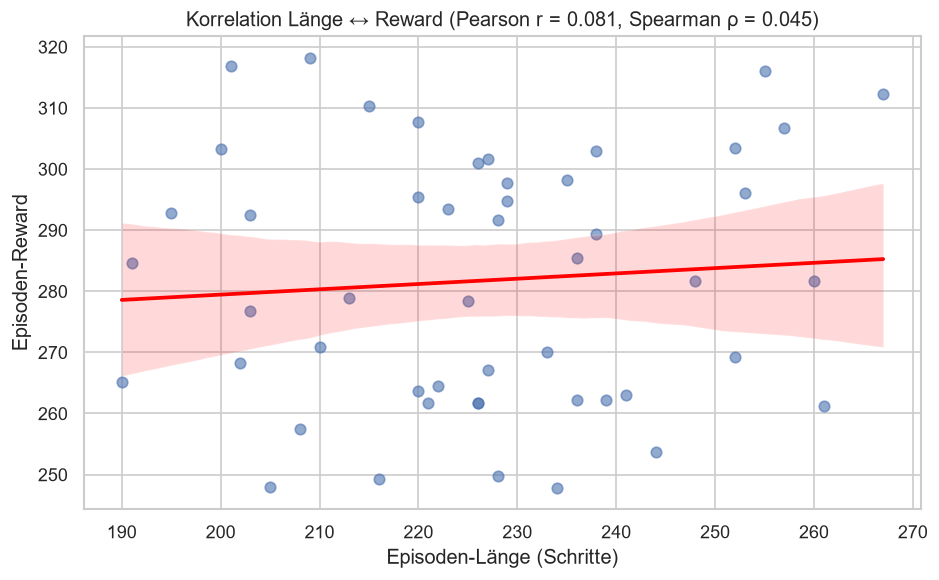
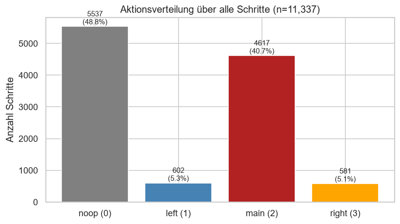
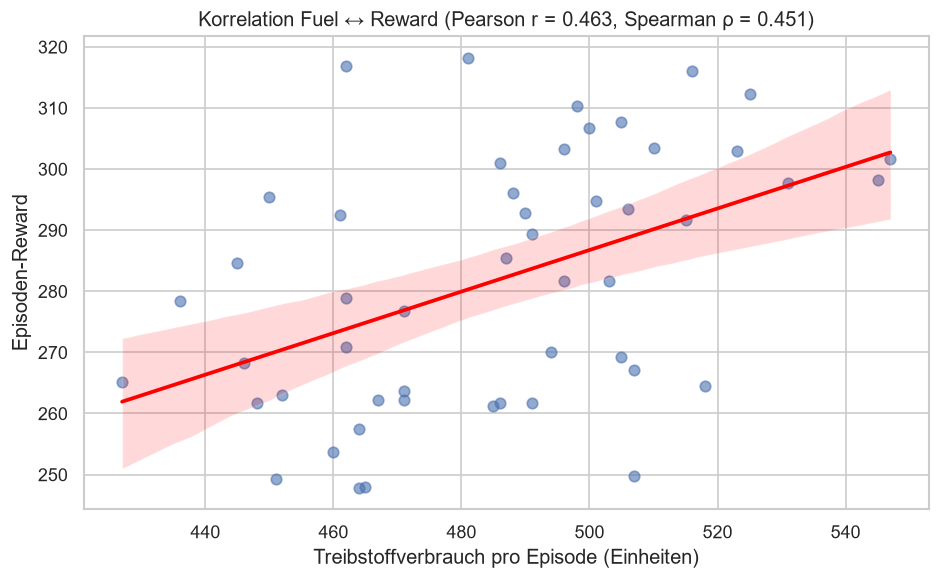
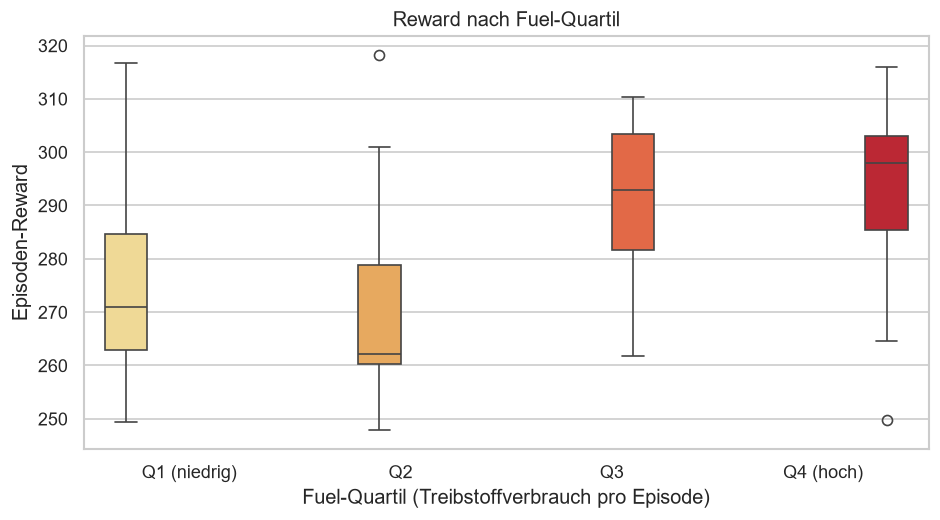
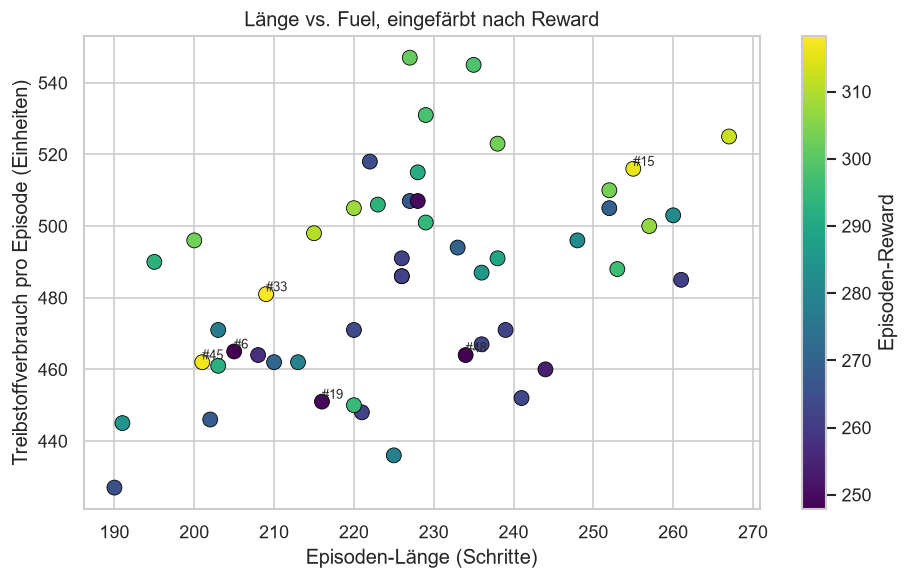
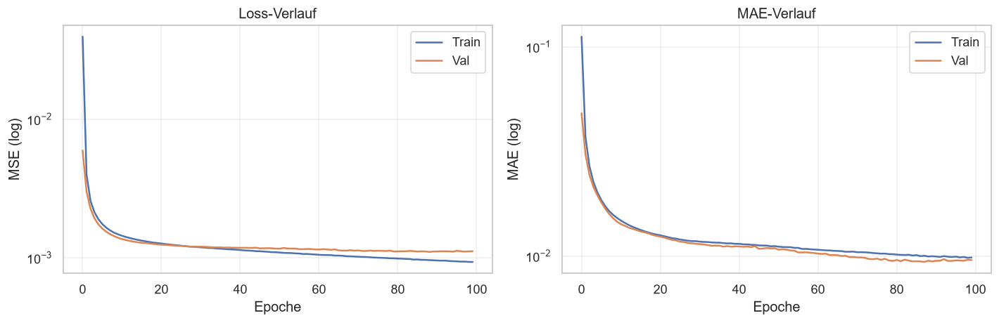
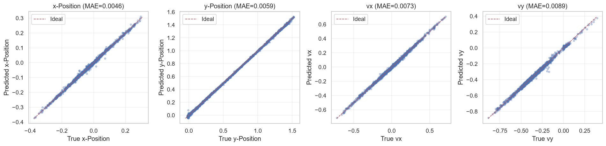
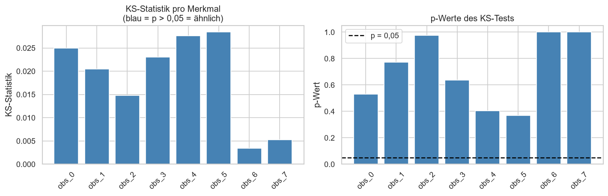
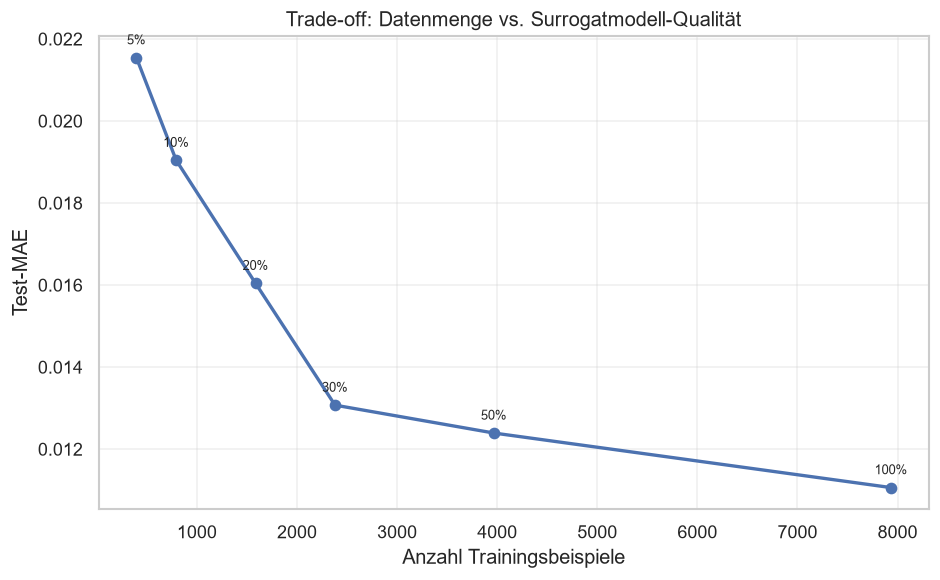

# 📊 B-KIPR01XX – KI-Programmierung


---

## 📖 INHALTSVERZEICHNIS

- [📝 PROJEKTBESCHREIBUNG](#-projektbeschreibung)
- [📈 ERGEBNISSE](#-ergebnisse)
- [✨ FEATURES](#-features)
- [🚀 TOOL](#-tool)
- [📁 STRUKTUR](#-struktur)
- [⚡ QUICK START](#-quick-start)
- [⚠️ WICHTIGE HINWEISE](#️-wichtige-hinweise)
- [📝 LIZENZ](#-lizenz)
- [👤 AUTOR](#-autor)
- [📊 REPOSITORY STATISTIK](#-repository-statistik)

---

## 📝 PROJEKTBESCHREIBUNG

Diese Einsendeaufgabe befasst sich mit der **Anwendung von Reinforcement Learning und klassischer Data-Science-Methoden** auf die `LunarLander`-Umgebung der Bibliothek *Gymnasium* – basierend auf den Studieninhalten der Module *KI-Programmierung* (KIPR00, KIPR01) und der Begleitliteratur *Praxiseinstieg Machine Learning mit Scikit-Learn, Keras und TensorFlow* (Géron, 2023).

Ein trainierter **Proximal Policy Optimization (PPO)**-Agent (Stable-Baselines3) wird als Datengenerator genutzt: Er durchläuft 50 Episoden in der simulierten Umgebung, deren Beobachtungen, Aktionen und Belohnungen zu einem Datensatz aggregiert und anschließend mit explorativen, statistischen und Modellierungs-Methoden ausgewertet werden. Auf diese Weise entsteht – analog zu vielen anderen Data-Science-Aufgaben – ein einzigartiger Datensatz, der vollständig in einem Jupyter Notebook reproduziert werden kann.

Die Arbeit gliedert sich in sechs aufeinander aufbauende Aufgaben:

**1. Datenerhebung und explorative Analyse (Aufgabe 1)**
- 50 Episoden mit dem trainierten PPO-Agenten, Protokollierung von Beobachtung, Aktion, Belohnung und Folgezustand
- Deskriptive Statistik, Boxplots, Histogramme, Aktionsverteilung
- Korrelationsanalyse (Pearson, Spearman) zwischen Episodenlänge und Reward

**2. Feature Engineering – Treibstoffverbrauch (Aufgabe 2)**
- Mapping der vier Aktionen auf Treibstoffkosten (`noop=0`, `left=1`, `main=5`, `right=1`)
- Aggregation auf Episode-Ebene (`fuel_episode`), Validierung der Summen
- Analyse der Korrelation zwischen Treibstoffverbrauch und Reward

**3. Analyse des Treibstoff-Features (Aufgabe 3)**
- Quartilsanalyse des Treibstoffverbrauchs
- Kombinierte Darstellung von Länge und Treibstoff, farbcodiert nach Reward
- Diskussion des positiven Zusammenhangs als Selection-Bias

**4. Surrogatmodell (Aufgabe 4)**
- Mehrschichtiges Perzeptron (MLP) mit zwei verborgenen Schichten (64 Neuronen, ReLU)
- Features: 8-dimensionale Beobachtung + One-Hot-codierte Aktion (12 Eingaben)
- Zielgröße: 8-dimensionaler Folgezustand
- Training mit MSE-Verlust und Adam-Optimierer (100 Epochen)

**5. Early Stopping und Hyperparameter-Tuning (Aufgabe 5)**
- Early Stopping mit Geduld von 10 Epochen
- Keras Tuner (RandomSearch, 15 Trials) über Schichten, Neuronen, Aktivierung und Lernrate
- Vergleich von Baseline, Early Stopping und getuntem Modell

**6. Datenreduktion (Aufgabe 6)**
- Stratifiziertes Sampling nach Aktion (5 %, 10 %, 20 %, 30 %, 50 %)
- Kolmogorow-Smirnow-Test zur Prüfung der Verteilungstreue
- Trade-off-Analyse zwischen Datenmenge und Modellqualität

Die gesamte Simulation wurde in **Python 3.12** mit **TensorFlow 2.14** (CPU) und **Stable-Baselines3 2.9.2** implementiert, die Ergebnisse in einem **Jupyter Notebook** dokumentiert und in einer **LaTeX-Dokumentation** festgehalten.

---

## 📈 ERGEBNISSE

Die Auswertung liefert die folgenden Kernergebnisse. Eine vollständige Diskussion findet sich in der beigefügten PDF-Dokumentation.

### 🎯 Aufgabe 1 – Exploration des Agentenverhaltens

<p align="center">
  
  
</p>

**Kernergebnisse:**
- **Mittlerer Reward:** 281,77 ± 20,60 über 50 Episoden
- **Beste Episode:** Nr. 33 mit 318,23 in 209 Schritten
- **Schlechteste Episode:** Nr. 48 mit 247,86 in 234 Schritten
- **Korrelation Länge ↔ Reward:** Pearson r = 0,081, Spearman ρ = 0,045 – praktisch kein Zusammenhang
- **Aktionsverteilung:** noop 48,8 % | main 40,7 % | left 5,3 % | right 5,1 %

### ⛽ Aufgabe 2 – Treibstoffverbrauch

<p align="center">
  
</p>

**Kernergebnisse:**
- **Mittlerer Verbrauch:** 485,36 ± 28,04 Einheiten (Min. 427, Max. 547)
- **Validierung:** Summe `fuel_step` = Summe `fuel_episode` = 24 268
- **Korrelation Fuel ↔ Reward:** Pearson r = 0,463, Spearman ρ = 0,451 – moderat positiv

### 📊 Aufgabe 3 – Quartilsanalyse

<p align="center">
  
  
</p>

**Kernergebnisse:**
- **Q1 (niedrigster Verbrauch):** 275,28
- **Q2:** 270,47
- **Q3:** 289,66
- **Q4 (höchster Verbrauch):** 291,56
- **Korrelation Länge ↔ Fuel:** r = 0,474
- **Interpretation:** Positiver Zusammenhang als Selection-Bias – aktives Manövrieren korreliert mit präziser Landung

### 🧠 Aufgabe 4 – Surrogatmodell

<p align="center">
  
  
</p>

**Kernergebnisse:**
- **Test-MSE:** 0,00176
- **Test-MAE:** 0,01016
- **Kein Overfitting:** Validierungs- und Trainingsverlust verlaufen nahezu parallel
- **Höchster Dimensionsfehler:** Kontakt-Flags (MAE ≈ 0,017–0,018) – strukturell durch binäre 0/1-Übergänge bedingt

### 🔧 Aufgabe 5 – Early Stopping und Tuning

| Modell | Test-MSE | Test-MAE |
|--------|----------|----------|
| Baseline (100 Epochen, fix) | 0,001765 | 0,010162 |
| Mit Early Stopping | 0,001840 | 0,011061 |
| Getunt (Keras Tuner) | 0,001740 | 0,010086 |

**Kernergebnisse:**
- Early Stopping stoppt nach 64 statt 200 Epochen
- Beste Tuner-Konfiguration: 2 verborgene Schichten, 128 Neuronen, ReLU, Lernrate ≈ 2,45 · 10⁻⁴
- Tuning liefert keinen messbaren Zugewinn, da das Basismodell bereits im Optimum liegt

### 📉 Aufgabe 6 – Datenreduktion

<p align="center">
  
</p>

<p align="center">
  
</p>

**Kernergebnisse:**
- **Stratifiziertes Sampling** erhält die Aktionsverteilung exakt (Abweichung < 0,1 Prozentpunkte)
- **KS-Test:** Für alle 8 Beobachtungsdimensionen p > 0,05 im 10 %-Subset
- **Sweet Spot:** 30 % der Originaldaten (Test-MAE 0,01307 vs. 0,01106 bei 100 %)
- **Nicht-monotone Entwicklung** bei 5 % ist auf hohe Varianz bei kleinen Datensätzen zurückzuführen

**Vollständige Rohdaten:** Alle erzeugten CSV-Dateien sind in `B-KIPR01XX/data/` abgelegt (`TomaKing_A1_*.csv`, `TomaKing_A5_Modellvergleich.csv`, `TomaKing_A6_Datenverkleinerung.csv`).

---

## ✨ FEATURES

| Feature | Beschreibung |
|---------|-------------|
| 🎮 PPO-Agent (LunarLander) | Stable-Baselines3, 1,5 Mio. Timesteps, gespeichert als `*.zip` |
| 📊 Explorative Analyse | Deskriptive Statistik, Histogramme, Boxplots, Korrelationen |
| ⛽ Feature Engineering | Treibstoff-Mapping pro Aktion, Aggregation auf Episode-Ebene |
| 📈 Quartilsanalyse | Reward-Verteilung nach Treibstoffverbrauch |
| 🧠 Surrogatmodell | MLP mit zwei verborgenen Schichten (64 Neuronen, ReLU) |
| 🔧 Hyperparameter-Tuning | Keras Tuner (RandomSearch, 15 Trials) |
| 🛑 Early Stopping | Geduld 10 Epochen, Restore-Best-Weights |
| 📉 Datenreduktion | Stratifiziertes Sampling + KS-Test pro Dimension |
| 📋 Reproduzierbarkeit | Globaler Zufalls-Seed (42), gespeicherte Modelle |
| 📄 LaTeX-Dokumentation | Professionelles Layout mit allen Code-Listings und Plots |
| 🔗 Versionskontrolle | Git & GitHub für Nachvollziehbarkeit |

---

## 🚀 TOOL

| Bereich | Werkzeug |
|---------|----------|
| **Programmiersprache** | Python 3.12 |
| **Deep-Learning-Framework** | TensorFlow 2.14 (CPU), Keras 3.x |
| **Reinforcement Learning** | Stable-Baselines3 2.9.2 (PPO) |
| **Simulationsumgebung** | Gymnasium (LunarLander-v3) |
| **Data-Science-Bibliotheken** | pandas, matplotlib, seaborn, plotly, scikit-learn |
| **Hyperparameter-Tuning** | Keras Tuner (RandomSearch) |
| **Statistik** | SciPy (`ks_2samp`) |
| **Dokumentation** | LaTeX (TeXLive / Papeeria) |
| **Versionskontrolle** | Git & GitHub |

---

## 📁 STRUKTUR

```text
📓 B-KIPR01XX - KI-Programmierung/
├── 📄 README.md                                         # Diese Datei
├── 📄 main.tex                                          # LaTeX-Hauptdokument
│
├── 📁 B-KIPR01XX/                                       # Python-Notebook & Artefakte
│   ├── 📁 data/                                         # Erzeugte CSV-Dateien
│   │   ├── 📊 TomaKing_A1_steps.csv                     # Schritte aus Aufgabe 1
│   │   ├── 📊 TomaKing_A1_episodes.csv                  # Episoden aus Aufgabe 1
│   │   ├── 📊 TomaKing_A5_Modellvergleich.csv           # Modellvergleich (Aufgabe 5)
│   │   └── 📊 TomaKing_A6_Datenverkleinerung.csv        # Subset-Ergebnisse (Aufgabe 6)
│   │
│   ├── 📁 figures/                                      # Notebook-generierte Abbildungen
│   │   ├── 🖼️ TomaKing_A1_*.png                         # 4 Abbildungen
│   │   ├── 🖼️ TomaKing_A2_Fuel_vs_Reward.png
│   │   ├── 🖼️ TomaKing_A3_*.png                         # 2 Abbildungen
│   │   ├── 🖼️ TomaKing_A4_*.png                         # 2 Abbildungen
│   │   └── 🖼️ TomaKing_A6_*.png                         # 3 Abbildungen
│   │
│   ├── 📁 models/                                       # Trainierte Modelle
│   │   ├── 🤖 TomaKing_PPO_LunarLander.zip              # PPO-Agent (Stable-Baselines3)
│   │   ├── 🧠 TomaKing_A4_Surrogat_Baseline.keras
│   │   ├── 🧠 TomaKing_A5_Surrogat_EarlyStopping.keras
│   │   ├── 🧠 TomaKing_A5_Surrogat_Tuned.keras
│   │   └── 📁 TomaKing_A5_KerasTuner/                   # Tuner-Zwischenstände (15 Trials)
│   │
│   ├── 📁 notebooks/
│   │   └── 📓 B-KIPR01XX.ipynb                          # Jupyter Notebook (alle Analysen)
│   │
│   └── 📄 requirements.txt                              # Python-Abhängigkeiten
│
├── 📁 asset/                                            # LaTeX-Assets
│   ├── 📁 code/                                         # Ausgelagerte Code-Listings
│   │   └── 📝 Aufgabe2.py                               # Fuel-Mapping-Listing
│   │
│   └── 📁 image/                                        # LaTeX-Grafiken
│       ├── 🖼️ TomaKing_A1_*.png … TomaKing_A6_*.png     # Duplikate aus figures/
│       └── 🖼️ WBH.png                                   # Logo der Hochschule
│
├── 📁 chapter/                                          # LaTeX-Kapitel
│   ├── 📝 Einleitung.tex
│   ├── 📝 Aufgabe1.tex … Aufgabe6.tex
│   └── 📝 Fazit.tex
│
└── 📁 config/                                           # LaTeX-Konfiguration
    ├── 📝 acronym.tex                                   # Abkürzungsverzeichnis
    ├── 📝 bibliography.bib                              # Literaturverzeichnis
    ├── 📝 settings.tex                                  # Dokument-Einstellungen
    └── 📝 titlepage.tex                                 # Titelseite
```

### 📁 Struktur-Legende
```text
📓 B-KIPR01XX - KI-Programmierung/
├── 📄 README.md              # Projektbeschreibung (diese Datei)
├── 📄 main.tex               # LaTeX-Hauptdokument
├── 📁 B-KIPR01XX/            # Notebook, Daten, Modelle
│   ├── 📁 data/              # Erzeugte CSVs (Aufgaben 1, 5, 6)
│   ├── 📁 figures/           # Abbildungen aus dem Notebook
│   ├── 📁 models/            # PPO-Agent + Surrogatmodelle
│   └── 📁 notebooks/         # Jupyter Notebook
├── 📁 asset/                 # LaTeX-Assets
│   ├── 📁 code/              # Code-Listings (*.py)
│   └── 📁 image/             # LaTeX-Grafiken (Screenshots, Plots, WBH-Logo)
├── 📁 chapter/               # LaTeX-Kapitel (Einleitung + Aufgabe 1–6 + Fazit)
└── 📁 config/                # LaTeX-Konfiguration
```

---

## ⚡ QUICK START

### 🔧 Voraussetzungen
- **Python 3.12** (empfohlen über `venv` oder `Anaconda`)
- **Git** (optional, für Versionskontrolle)
- **LaTeX-Distribution** (z. B. TeXLive oder MiKTeX) – für die PDF-Erstellung

### 📦 Git & GitHub
```bash
# Repository klonen
git clone https://github.com/mucahid-emin-tomakin/AcademicPortfolio.git
cd AcademicPortfolio

# Ins Projektverzeichnis wechseln
cd "Bachelor - Kuenstliche Intelligenz und Maschinelles Lernen/B-KIPR01XX - KI-Programmierung"
```

### 🐍 Python-Umgebung einrichten (isolierte Umgebung)
```bash
# In den Projektordner wechseln
cd B-KIPR01XX

# Virtuelle Umgebung erstellen und aktivieren
python -m venv venv
# Windows:
venv\Scripts\activate
# macOS/Linux:
source venv/bin/activate

# Benötigte Pakete installieren
pip install -r requirements.txt
```

### 📓 Jupyter Notebook starten
```bash
cd B-KIPR01XX
jupyter notebook notebooks/B-KIPR01XX.ipynb
```
Das Notebook ist so aufgebaut, dass es von oben nach unten ausgeführt werden kann. Der trainierte PPO-Agent wird aus `models/TomaKing_PPO_LunarLander.zip` geladen – ein Neutraining (ca. 25 Minuten) ist nicht erforderlich. Die drei Surrogatmodelle werden ebenfalls aus `models/` geladen.

### 📝 LaTeX-Kompilierung

**Option A: Lokal mit LaTeX**
```bash
latexmk -pdf main.tex
```

**Option B: Docker (empfohlen, keine lokale LaTeX-Installation nötig)**
```bash
docker run --rm -v "${PWD}:/work" -w /work texlive/texlive latexmk -pdf main.tex
```

**Option C: Online mit Papeeria**
```bash
# 1. Gehe auf https://m.papeeria.com
# 2. Erstelle ein neues Projekt und importiere den gesamten Ordner als ZIP
# 3. Papeeria kompiliert main.tex automatisch in der Cloud
```

### 🔁 Reproduzierbarkeit
Alle Ergebnisse sind durch einen globalen Zufalls-Seed (`TK_SEED = 42`) deterministisch reproduzierbar. Der PPO-Agent wurde mit dem in der Aufgabenstellung vorgegebenen Code trainiert; einzige Anpassungen waren die Umgebungs-ID (`LunarLander-v3` statt `-v2`) und der Seed.

---

## ⚠️ WICHTIGE HINWEISE

- 🔒 **CSV-Trennzeichen** – die CSV-Dateien in `data/` verwenden das Komma `,` als Trennzeichen (RFC-4180) und den Punkt `.` als Dezimaltrennzeichen. Beim Öffnen in deutschem Excel bitte „Daten → Aus Text/CSV" wählen und als Trennzeichen das Komma angeben.
- 🎓 **Eigenständigkeit** – alle Analysen, Modelle und Auswertungen wurden eigenständig implementiert und reflektiert.
- 🤖 **KI-Transparenz** – gemäß den WBH-Vorgaben wird der Einsatz von Coding-Assistenten in der Dokumentation offengelegt.
- 📚 **Quellenangaben** – alle zitierten Aussagen sind mit den Studienheften [KIPR00, KIPR01] und Géron (2023) hinterlegt.
- 🧪 **Reproduzierbarkeit** – alle Zufallszahlen sind durch Seeds fixiert (`TK_SEED = 42`), sodass die Ergebnisse deterministisch reproduzierbar sind.
- 🌍 **Plattformunabhängigkeit** – entwickelt unter Windows 11, die verwendeten Tools sind plattformunabhängig.
- 📌 **Modell-Zwischenstände** – der Ordner `TomaKing_A5_KerasTuner/` enthält die Zwischenstände aller 15 Tuner-Trials. Für die Nutzung des finalen Modells genügt `TomaKing_A5_Surrogat_Tuned.keras`.
- 📄 **PDF-Dokumentation** – die PDF ist Teil der Abgabe und liegt im Projektordner (`B-KIPR01XX - KI-Programmierung.pdf`).

---

## 📝 LIZENZ

Dieses Projekt ist unter der **MIT License** lizenziert – frei für persönliche und kommerzielle Nutzung.

---

## 👤 AUTOR

**Mücahid Emin Tomakin (TomaKing)**

| Platform | Link | Icon |
|----------|------|------|
| **GitHub** | [@mucahid-emin-tomakin](https://github.com/mucahid-emin-tomakin) | 🐙 |
| **Studium** | B.Sc. Künstliche Intelligenz & Maschinelles Lernen | 🎓 |

**Über dieses Repository:**

- 📘 Typ: Einsendeaufgabe / Fachdokumentation
- 🎯 Ziel: Reinforcement Learning, Feature Engineering, Surrogatmodelle und Datenreduktion am Beispiel der LunarLander-Umgebung
- 🛠️ Werkzeuge: Python, TensorFlow, Keras, Stable-Baselines3, Gymnasium, scikit-learn, LaTeX, Git

---

## 📊 REPOSITORY STATISTIK

| Metrik | Wert | Trend |
|--------|------|-------|
| **Stars** |  | 📈 |
| **Forks** |  | 🔄 |
| **Issues** |  | ✅ |
| **Letztes Update** |  | 🕐 |

---

### 🔧 Made with ❤️ on LaTeX, Python, TensorFlow, Keras, and Stable-Baselines3
